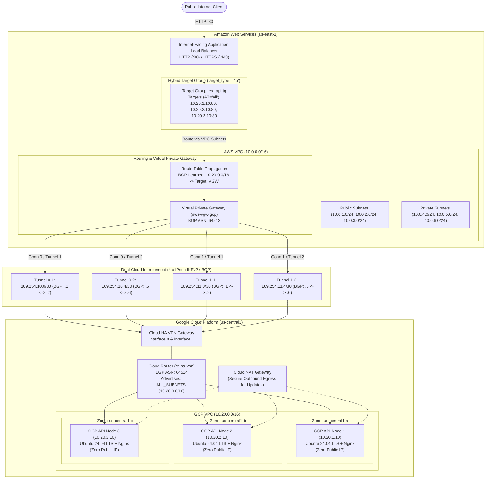

# Enterprise Multi-Cloud Ingress: AWS Application Load Balancer to GCP Private Compute via Site-to-Site HA VPN & IP Target Groups

[](https://www.terraform.io)
[](https://registry.terraform.io/providers/hashicorp/aws/latest)
[](https://registry.terraform.io/providers/hashicorp/google/latest)
[](#high-availability-architecture)
[](#network-topology--bgp-addressing-matrix)
[](LICENSE)

An enterprise-grade, automated Terraform configuration establishing an end-to-end multi-cloud ingress architecture:
- **Edge Ingress**: Amazon Web Services (AWS) **Internet-Facing Application Load Balancer (ALB)** distributed across Availability Zones.
- **Hybrid Core**: AWS **IP-type Target Group** (`target_type = "ip"`, `availability_zone = "all"`) routing traffic seamlessly to private IP addresses outside the AWS VPC.
- **Resilient Transport**: AWS **Virtual Private Gateway (VGW)** coupled with GCP **Cloud HA VPN** via **4 active IPsec IKEv2 tunnels** and dynamic **BGP routing** (with multi-tunnel automatic failover).
- **Private External API Backend**: Multi-zone **Ubuntu 24.04 LTS Nginx** API web nodes in Google Cloud Platform (GCP) private subnets with **zero public IP addresses**, enabled with Cloud NAT for secure package updates and Google Cloud Identity-Aware Proxy (IAP) for bastionless administration.

---

## Table of Contents

- [Architectural Overview](#architectural-overview)
- [Visual Proof of Deployment](#visual-proof-of-deployment)
- [Traffic Flow & Packet Lifecycle](#traffic-flow--packet-lifecycle)
- [Network Topology & BGP Addressing Matrix](#network-topology--bgp-addressing-matrix)
- [High Availability Architecture](#high-availability-architecture)
- [Security & Zero-Trust Posture](#security--zero-trust-posture)
- [Repository Structure](#repository-structure)
- [Prerequisites & IAM Permissions](#prerequisites--iam-permissions)
- [Deployment Guide](#deployment-guide)
- [Verification & Day-2 Operations](#verification--day-2-operations)
- [Troubleshooting Runbook](#troubleshooting-runbook)
- [Terraform Specifications](#terraform-specifications)
- [Decommissioning](#decommissioning)

---

## Architectural Overview

This solution enables organizations to utilize AWS Application Load Balancers as an enterprise ingress point, terminating public HTTP/HTTPS traffic and routing requests directly to private compute infrastructure or API workloads hosted across clouds inside Google Cloud Platform (GCP) private subnets—without exposing GCP workloads to the public internet.



---

## Visual Proof of Deployment

The following screenshots from live production Google Cloud Platform and Amazon Web Services consoles validate the deployed infrastructure:

### 1. Successful Terraform Provisioning
Provisioning completed with 32 resources added across AWS and GCP, outputting the ALB DNS name (`prod-public-alb-1809782473.us-east-1.elb.amazonaws.com`), Target Group ARN, AWS VPN Connection IDs, and GCP private instance IPs (`10.20.1.10`, `10.20.2.10`, `10.20.3.10`):


---

### 2. AWS Ingress & Routing Infrastructure

#### AWS Internet-Facing Application Load Balancer
Active ALB `prod-public-alb` distributed across 3 Availability Zones (`us-east-1a`, `us-east-1b`, `us-east-1c`) with an HTTP:80 listener forwarding 100% of incoming traffic to the IP Target Group `prod-ext-api-tg`:


#### AWS Virtual Private Gateway (VGW)
`prod-aws-vgw-gcp` (`vgw-074a889506430bcde`) in `Available` state, attached to `prod-aws-vpc` with Amazon ASN `64512`:


#### AWS Customer Gateways
Dual Customer Gateways mapping directly to GCP Cloud HA VPN interfaces (`34.184.42.159` and `34.183.19.113`) with Google BGP ASN `64514`:


#### AWS Site-to-Site VPN Connections
Both redundant VPN connections (`vpn-076964b52a7f7aa69` and `vpn-020bf256f36f882dc`) in `Available` state attached to the Virtual Private Gateway:


---

### 3. Google Cloud Platform (GCP) HA VPN & BGP Network Fabric

#### Cloud HA VPN Tunnels (All 4 BGP Sessions Established)
All four IPsec IKEv2 tunnels actively established with concurrent dynamic BGP sessions:
- `prod-ha-vpn-tunnel-0-1`: Interface 0 $\leftrightarrow$ `54.90.161.249` (BGP `169.254.10.2` / `169.254.10.1`) — **Established / BGP established**
- `prod-ha-vpn-tunnel-0-2`: Interface 0 $\leftrightarrow$ `54.210.242.173` (BGP `169.254.10.6` / `169.254.10.5`) — **Established / BGP established**
- `prod-ha-vpn-tunnel-1-1`: Interface 1 $\leftrightarrow$ `3.85.149.149` (BGP `169.254.11.2` / `169.254.11.1`) — **Established / BGP established**
- `prod-ha-vpn-tunnel-1-2`: Interface 1 $\leftrightarrow$ `18.233.67.42` (BGP `169.254.11.6` / `169.254.11.5`) — **Established / BGP established**


#### Cloud Router BGP Status
GCP Cloud Router `prod-cr-ha-vpn` (ASN `64514`) managing all 4 BGP peering sessions with healthy status checks:


#### Cloud HA VPN Gateway
Dual interfaces terminating on distinct Google border network routing engines (`34.183.19.113` on Interface 0 and `34.184.42.159` on Interface 1):


#### Peer VPN Gateway (4 Public IPs)
GCP External Gateway configured with `FOUR_IPS_REDUNDANCY` mapping to AWS's 4 public VPN endpoints:


---

### 4. GCP Private Backend Compute Instances

#### Multi-Zone Private Compute Engine VMs
Three Ubuntu 24.04 LTS instances running across `us-central1-a`, `us-central1-b`, and `us-central1-c` (`prod-gcp-api-1`, `prod-gcp-api-2`, `prod-gcp-api-3`) with internal IPs (`10.20.1.10`, `10.20.2.10`, `10.20.3.10`) and strictly **zero external public IPs**:


---

### 5. End-to-End Live Ingress Validation

#### Public Traffic Routed via AWS ALB to GCP Private Backend
Live web browser request hitting the public AWS ALB DNS endpoint (`http://prod-public-alb-1809782473.us-east-1.elb.amazonaws.com`), displaying the HTML response served by private GCP Compute instance `prod-gcp-api-1` (`10.20.1.10`) over the multi-cloud IPsec VPN:


---

## Traffic Flow & Packet Lifecycle

### 1. Ingress Journey (Client to GCP Private Backend)
1. **Public Client Request**: A user sends an HTTP request to the AWS Application Load Balancer DNS name (e.g., `prod-public-alb-1809782473.us-east-1.elb.amazonaws.com`).
2. **ALB Termination & Connection Pooling**: The ALB terminates the TCP/HTTP connection on port 80. The listener executes a forward action pointing to the IP Target Group (`ext-api-tg`).
3. **Hybrid Target Group Routing**: The target group routes the request to one of the registered external private IPs (`10.20.1.10`, `10.20.2.10`, `10.20.3.10`). Because the target type is `ip` and the address is outside the AWS VPC, AWS requires `availability_zone = "all"`.
4. **VPC Route Lookup**: The ALB node initiates a new TCP connection from its private IP in the AWS public subnet (`10.0.1.0/24`, `10.0.2.0/24`, or `10.0.3.0/24`). The VPC route table matches the BGP-propagated prefix `10.20.0.0/16` pointing to the Virtual Private Gateway (`vgw-*`).
5. **IPsec Encapsulation & ECMP**: AWS VGW encapsulates the packet into IPsec ESP and distributes the traffic across the 4 active IPsec tunnels using BGP Equal-Cost Multi-Path (ECMP).
6. **Decapsulation at GCP HA VPN**: The GCP Cloud HA VPN Gateway decapsulates the packet and places it onto the GCP VPC routing fabric.
7. **Delivery & Ingress Filtering**: The packet reaches the target Compute Engine instance. The GCP VPC firewall rule (`allow-from-aws-alb`) validates the source IP is from `10.0.0.0/16` and allows the TCP connection on port 80.

### 2. Symmetrical Egress Return Journey (GCP Private Backend back to Client)
> [!IMPORTANT]
> **Deterministic Symmetrical Routing**: Backend instances in GCP receive packets whose source IP is an AWS ALB node's private IP within `10.0.0.0/16`. Because GCP Cloud Router learns the AWS VPC CIDR (`10.0.0.0/16`) dynamically via BGP from the AWS Virtual Private Gateway, the return packets match the learned BGP route and are routed directly back through the GCP HA VPN tunnels to the AWS VGW. This guarantees symmetrical bidirectional communication without requiring NAT traversal or risking asymmetric connection drops.

---

## Network Topology & BGP Addressing Matrix

### Cross-Cloud Network Parameters

| Parameter | Amazon Web Services (AWS) | Google Cloud Platform (GCP) |
| :--- | :--- | :--- |
| **Region / Zones** | `us-east-1` (`us-east-1a`, `us-east-1b`, `us-east-1c`) | `us-central1` (`us-central1-a`, `us-central1-b`, `us-central1-c`) |
| **VPC CIDR** | `10.0.0.0/16` | `10.20.0.0/16` |
| **Subnets** | Public: `10.0.1.0/24`, `10.0.2.0/24`, `10.0.3.0/24`<br/>Private: `10.0.4.0/24`, `10.0.5.0/24`, `10.0.6.0/24` | Private API: `10.20.1.0/24`, `10.20.2.0/24`, `10.20.3.0/24` |
| **BGP ASN** | `64512` (Virtual Private Gateway) | `64514` (Cloud Router) |
| **Ingress Component** | Internet-Facing Application Load Balancer (ALB) | Cloud HA VPN Gateway |
| **Workload Endpoints** | IP Target Group (`availability_zone = "all"`) | Compute Engine VMs: `10.20.1.10`, `10.20.2.10`, `10.20.3.10` |

### 4-Tunnel HA VPN Interconnect Matrix

Inside IP CIDRs are non-overlapping `/30` subnets allocated within `169.254.0.0/16`, deliberately avoiding AWS-reserved ranges (`169.254.0.0/30`–`169.254.5.0/30`, `169.254.169.252/30`):

| Tunnel ID | AWS VPN Conn | AWS Tunnel | GCP Interface | Peer Interface | Inside CIDR | AWS VGW IP | GCP Router IP | Pre-Shared Key |
| :--- | :--- | :--- | :--- | :--- | :--- | :--- | :--- | :--- |
| **`0-1`** | `vpn_conn_0` | Tunnel 1 | Interface 0 | Interface 0 | `169.254.10.0/30` | `169.254.10.1` | `169.254.10.2` | `vpn_<random_32_chars>` |
| **`0-2`** | `vpn_conn_0` | Tunnel 2 | Interface 0 | Interface 1 | `169.254.10.4/30` | `169.254.10.5` | `169.254.10.6` | `vpn_<random_32_chars>` |
| **`1-1`** | `vpn_conn_1` | Tunnel 1 | Interface 1 | Interface 2 | `169.254.11.0/30` | `169.254.11.1` | `169.254.11.2` | `vpn_<random_32_chars>` |
| **`1-2`** | `vpn_conn_1` | Tunnel 2 | Interface 1 | Interface 3 | `169.254.11.4/30` | `169.254.11.5` | `169.254.11.6` | `vpn_<random_32_chars>` |

> [!NOTE]
> **AWS PSK Format Constraint**: AWS Site-to-Site VPN enforces that tunnel pre-shared keys must be 8–64 characters and **cannot start with the character `0` (zero)**. The configuration uses a deterministic prefix format `vpn_${random_password.psk[k].result}` to ensure strict compliance.

---

## High Availability Architecture

Google Cloud HA VPN coupled with AWS Virtual Private Gateway provides a production-grade, highly available interconnect topology when configured with 4 active tunnels terminating on redundant peer gateway endpoints:

```
                  +-----------------------------+
                  |  AWS Virtual Private Gateway|
                  |      (Amazon ASN 64512)     |
                  +--------------+--------------+
                                 |
                  +--------------+--------------+
                  |     AWS External CGWs       |
                  | [CGW 0: IP_A] [CGW 1: IP_B] |
                  +-------+-------------+-------+
                          |             |
           +--------------+--+       +--+--------------+
           |                 |       |                 |
      [Tunnel 0-1]      [Tunnel 0-2] [Tunnel 1-1]      [Tunnel 1-2]
           |                 |       |                 |
           +--------------+--+       +--+--------------+
                          |             |
                  +-------+-------------+-------+
                  |    GCP HA VPN Gateway       |
                  | [If 0: IP_A]  [If 1: IP_B]  |
                  +-----------------------------+
```

1. **Dual GCP Interfaces**: Terminating on two distinct Google Cloud border network routing engines.
2. **Dual AWS VPN Connections**: Bound to separate Customer Gateways with sequential locking (`depends_on = [aws_vpn_connection.vpn_conn_0]`) preventing AWS `ConcurrentMutationLimitExceeded` API exceptions.
3. **Autonomous Dynamic Failover**: BGP sessions exchange keepalives every 30 seconds (hold timer 90 seconds). If any tunnel or gateway degrades, routes automatically withdraw and converge over surviving tunnels in seconds.

---

## Security & Zero-Trust Posture

- **Zero Public IP Exposure on Backend Workloads**: GCP Compute Engine instances reside strictly in private subnets with no `access_config` block (strictly no public IP). They cannot be accessed directly from the public internet.
- **Outbound Package Management via Cloud NAT**: GCP instances download OS packages (`apt-get install -y nginx`) and security patches through Google Cloud NAT, preventing direct inbound ingress.
- **Bastionless Administration via IAP**: Port 22 is restricted exclusively to Google Cloud Identity-Aware Proxy (`35.235.240.0/20`), enabling encrypted, audited SSH sessions without bastion hosts or open internet ports.
- **Strict Ingress Filtering**:
  ```hcl
  # GCP Firewall Rule: Allow only AWS VPC traffic over VPN
  allow_list = [
    {
      protocol = "tcp"
      ports    = ["80", "443"]
    }
  ]
  source_ranges = ["10.0.0.0/16"] # AWS VPC CIDR
  ```
- **Cryptographic Key Management**: IPsec IKEv2 pre-shared keys are generated automatically using Terraform's CSPRNG `random_password` resource with high entropy (32 alphanumeric characters).

---

## Repository Structure

```
.
├── .github/
│   └── workflows/
│       └── terraform-ci.yml                 # Automated Terraform fmt and validate CI
├── Makefile                                # Operational lifecycle targets (init, plan, apply, test)
├── README.md                               # Architecture and operations guide
├── screenshots/                            # Live deployment validation screenshots
│   ├── Screenshot from 2026-11-04 15-20-23.png
│   ├── Screenshot from 2026-11-04 15-21-16.png
│   ├── Screenshot from 2026-11-04 15-22-12.png
│   ├── Screenshot from 2026-11-04 15-22-22.png
│   ├── Screenshot from 2026-11-04 15-22-30.png
│   ├── Screenshot from 2026-11-04 15-22-49.png
│   ├── Screenshot from 2026-11-04 15-22-57.png
│   ├── Screenshot from 2026-11-04 15-23-08.png
│   ├── Screenshot from 2026-11-04 15-23-14.png
│   ├── Screenshot from 2026-11-04 15-23-43.png
│   └── Screenshot from 2026-11-04 15-24-46.png
└── terraform/
    ├── main.tf                             # Cross-cloud orchestration (VGW, HA VPN, Compute, ALB)
    ├── variables.tf                        # Input variable definitions and defaults
    ├── outputs.tf                          # Infrastructure endpoints, IDs, and testing commands
    ├── provider.tf                         # Provider constraints (AWS ~> 6.0, GCP ~> 8.0)
    ├── terraform.tfvars                    # Active environment variables
    ├── terraform.tfvars.example            # Sample configuration template
    └── modules/
        ├── aws/
        │   ├── load-balancer/              # Application & Network Load Balancer module
        │   ├── security-groups/            # Reusable AWS security group module
        │   ├── vpc/                        # Modular AWS VPC with IGW & NAT Gateway
        │   ├── launch_template/            # Launch template module
        │   └── auto_scaling_group/         # ASG module
        └── gcp/
            ├── vpc/                        # GCP VPC, subnets, and firewall rules
            ├── lb/                         # GCP LB module
            └── network_endpoint_groups/    # GCP NEG module
```

---

## Prerequisites & IAM Permissions

### 1. Local Tooling
- **Terraform**: `v1.5.0` or higher (tested with `v1.11.x`)
- **AWS CLI**: `v2.x` configured with `aws configure`
- **Google Cloud SDK**: `gcloud` authenticated via `gcloud auth application-default login`
- **cURL**: For automated endpoint testing

### 2. Required Cloud Permissions
- **AWS IAM**:
  - `ec2:*` (VPC, VGW, Customer Gateways, VPN Connections, Route Tables)
  - `elasticloadbalancing:*` (Application Load Balancer, Target Groups, Listeners)
- **GCP IAM**:
  - `roles/compute.networkAdmin` (VPC, Subnets, Firewalls, HA VPN, Cloud Router, Cloud NAT)
  - `roles/compute.instanceAdmin.v1` (Compute Engine instances)
  - `roles/iam.serviceAccountUser`

---

## Deployment Guide

### Step 1: Configure Environment Variables
Navigate to the `terraform/` directory:
```bash
cd terraform/
cp terraform.tfvars.example terraform.tfvars
```

Update `terraform.tfvars` with your project parameters:
```hcl
aws_region      = "us-east-1"
azs             = ["us-east-1a", "us-east-1b", "us-east-1c"]
aws_vpc_cidr    = "10.0.0.0/16"
public_subnets  = ["10.0.1.0/24", "10.0.2.0/24", "10.0.3.0/24"]
private_subnets = ["10.0.4.0/24", "10.0.5.0/24", "10.0.6.0/24"]

gcp_project_id      = "<YOUR_GCP_PROJECT_ID>"
gcp_region          = "us-central1"
gcp_zones           = ["us-central1-a", "us-central1-b", "us-central1-c"]
gcp_vpc_cidr        = "10.20.0.0/16"
gcp_private_subnets = ["10.20.1.0/24", "10.20.2.0/24", "10.20.3.0/24"]
environment         = "prod"
```

### Step 2: Initialize & Validate
```bash
# Using Makefile from root
make init
make validate

# Or directly with Terraform
cd terraform/
terraform init
terraform validate
```

### Step 3: Review Execution Plan
```bash
make plan
# Or: terraform -chdir=terraform plan -var-file="terraform.tfvars"
```

### Step 4: Apply & Provision Infrastructure
```bash
make apply
# Or: terraform -chdir=terraform apply -var-file="terraform.tfvars"
```
*Provisioning takes approximately 4–6 minutes while AWS creates the Virtual Private Gateway and ALB, and GCP provisions the Cloud HA VPN Gateway and Compute Engine instances.*

Upon completion, Terraform outputs all connection details:


---

## Verification & Day-2 Operations

### 1. Verify AWS VPN Tunnels & BGP State
Run the AWS command generated in the Terraform outputs:
```bash
$(terraform -chdir=terraform output -raw bgp_status_aws_command)
```
**Expected Output**:
All four tunnels will report `Status: UP` with dynamic BGP status `UP`.

### 2. Verify GCP Cloud Router BGP Peering
Run the GCP status command from outputs:
```bash
$(terraform -chdir=terraform output -raw bgp_status_gcp_command)
```
**Expected Output**:
All 4 BGP peers (`bgp-peer-0-1`, `bgp-peer-0-2`, `bgp-peer-1-1`, `bgp-peer-1-2`) report:
```yaml
bgpPeerStatus:
  - name: prod-bgp-peer-0-1
    status: ESTABLISHED
    numLearnedRoutes: 4
  - name: prod-bgp-peer-0-2
    status: ESTABLISHED
  - name: prod-bgp-peer-1-1
    status: ESTABLISHED
  - name: prod-bgp-peer-1-2
    status: ESTABLISHED
```

### 3. Verify AWS Target Group Health
Query the target health of the registered private IP endpoints across the VPN:
```bash
TG_ARN=$(terraform -chdir=terraform output -raw target_group_arn)
aws elbv2 describe-target-health --target-group-arn "$TG_ARN" --query 'TargetHealthDescriptions[*].[Target.Id,TargetHealth.State]' --output table
```
**Expected Output**:
```text
--------------------------------
|     DescribeTargetHealth     |
+--------------+---------------+
|  10.20.1.10  |  healthy      |
|  10.20.2.10  |  healthy      |
|  10.20.3.10  |  healthy      |
+--------------+---------------+
```

### 4. Live Traffic Validation
Execute the automated test target or query the ALB DNS endpoint:
```bash
make test
```
Or run a multi-request curl loop to observe multi-zone load balancing:
```bash
ALB_DNS=$(terraform -chdir=terraform output -raw alb_dns_name)
echo "Querying AWS ALB endpoint: http://${ALB_DNS}"

for i in {1..6}; do
  curl -s "http://${ALB_DNS}" | grep -E "(Instance Name|GCP Zone|Private IP|Origin Cloud)"
  sleep 1
done
```
**Sample Output demonstrating load distribution across GCP private compute instances**:
```html
<p><b>Instance Name:</b> prod-gcp-api-1</p>
<p><b>GCP Zone:</b> us-central1-a</p>
<p><b>Private IP:</b> 10.20.1.10</p>
---
<p><b>Instance Name:</b> prod-gcp-api-2</p>
<p><b>GCP Zone:</b> us-central1-b</p>
<p><b>Private IP:</b> 10.20.2.10</p>
---
<p><b>Instance Name:</b> prod-gcp-api-3</p>
<p><b>GCP Zone:</b> us-central1-c</p>
<p><b>Private IP:</b> 10.20.3.10</p>
```

Live browser confirmation:


---

## Troubleshooting Runbook

| Symptom | Probable Root Cause | Diagnostic & Remediation Steps |
| :--- | :--- | :--- |
| **BGP Status `CONNECT` or `IDLE`** | IPsec IKEv2 SA negotiation failure or link-local IP mismatch | 1. Check IPsec tunnel state: `aws ec2 describe-vpn-connections --vpn-connection-ids <CONN_ID>`<br/>2. Verify pre-shared key format (must not start with `0`).<br/>3. Verify inside CIDRs avoid AWS reserved blocks (`169.254.0.0/30`-`169.254.5.0/30`). |
| **Target Group Status `unhealthy`** | Route table missing VGW route or GCP firewall blocking ALB | 1. Ensure AWS VPC route tables have route propagation enabled (`aws_vpn_gateway_route_propagation`).<br/>2. Inspect GCP firewall rule: Confirm TCP port 80 is allowed from AWS CIDR `10.0.0.0/16`.<br/>3. Connect to GCP VM via IAP SSH: `curl -I http://localhost:80` to verify Nginx is active. |
| **`availability_zone` error in target attachment** | Target is outside VPC and `availability_zone` was omitted | For IP targets outside the VPC, AWS ELB requires `availability_zone = "all"`. Ensure this parameter is set in `aws_lb_target_group_attachment`. |
| **`ConcurrentMutationLimitExceeded`** | AWS rate-limiting simultaneous VPN connections on a single VGW | Ensure `aws_vpn_connection.vpn_conn_1` includes `depends_on = [aws_vpn_connection.vpn_conn_0]`. |

---

## Terraform Specifications

### Inputs

| Name | Description | Type | Default | Required |
| :--- | :--- | :--- | :--- | :---: |
| `aws_region` | AWS deployment region | `string` | `"us-east-1"` | no |
| `azs` | AWS Availability Zones | `list(string)` | `["us-east-1a", ...]` | no |
| `aws_vpc_cidr` | CIDR block for the AWS VPC | `string` | `"10.0.0.0/16"` | no |
| `public_subnets` | CIDR blocks for AWS public subnets (housing the ALB) | `list(string)` | `["10.0.1.0/24", ...]` | no |
| `private_subnets` | CIDR blocks for AWS private subnets | `list(string)` | `["10.0.4.0/24", ...]` | no |
| `aws_bgp_asn` | BGP ASN for AWS Virtual Private Gateway | `number` | `64512` | no |
| `gcp_project_id` | Target Google Cloud Project ID | `string` | n/a | **yes** |
| `gcp_region` | GCP deployment region for HA VPN & Cloud Router | `string` | `"us-central1"` | no |
| `gcp_zones` | GCP Availability Zones for backend subnets | `list(string)` | `["us-central1-a", ...]` | no |
| `gcp_vpc_cidr` | CIDR block for GCP VPC | `string` | `"10.20.0.0/16"` | no |
| `gcp_private_subnets`| CIDR blocks for GCP private backend subnets | `list(string)` | `["10.20.1.0/24", ...]` | no |
| `gcp_bgp_asn` | BGP ASN for GCP Cloud Router | `number` | `64514` | no |
| `gcp_machine_type` | Machine sizing for GCP private backend VMs | `string` | `"e2-small"` | no |
| `custom_external_endpoints` | Additional external private IPs to register in Target Group | `list(string)` | `[]` | no |
| `environment` | Deployment environment name | `string` | `"prod"` | no |
| `tags` | Resource tags applied to AWS resources | `map(string)` | `{ ... }` | no |

### Outputs

| Name | Description | Sensitive |
| :--- | :--- | :---: |
| `alb_dns_name` | Public DNS name of the AWS Application Load Balancer | no |
| `alb_arn` | ARN of the AWS Application Load Balancer | no |
| `target_group_arn` | ARN of the AWS IP Target Group fronting the private external API | no |
| `target_group_name` | Name of the AWS IP Target Group | no |
| `registered_external_endpoints` | List of target private IP endpoints registered in the ALB Target Group | no |
| `gcp_instance_names` | Names of the GCP backend API Compute Engine instances | no |
| `gcp_instance_private_ips` | Private IP addresses of the GCP backend instances | no |
| `aws_vpn_connection_ids` | IDs of the AWS Site-to-Site VPN connections | no |
| `bgp_status_aws_command` | AWS CLI command to verify VPN tunnel status and BGP telemetry | no |
| `bgp_status_gcp_command` | gcloud CLI command to verify GCP Cloud Router BGP state | no |
| `test_alb_curl_command` | Command to test live traffic distribution against the ALB endpoint | no |

---

## Decommissioning

To destroy all cloud infrastructure in an orderly, dependency-aware manner:

```bash
make destroy
# Or: terraform -chdir=terraform destroy -var-file="terraform.tfvars"
```

> [!CAUTION]
> Destroying this configuration will terminate the IPsec tunnels, tear down the AWS Application Load Balancer, and destroy the backend GCP compute instances. Ensure DNS traffic has been redirected prior to teardown.
